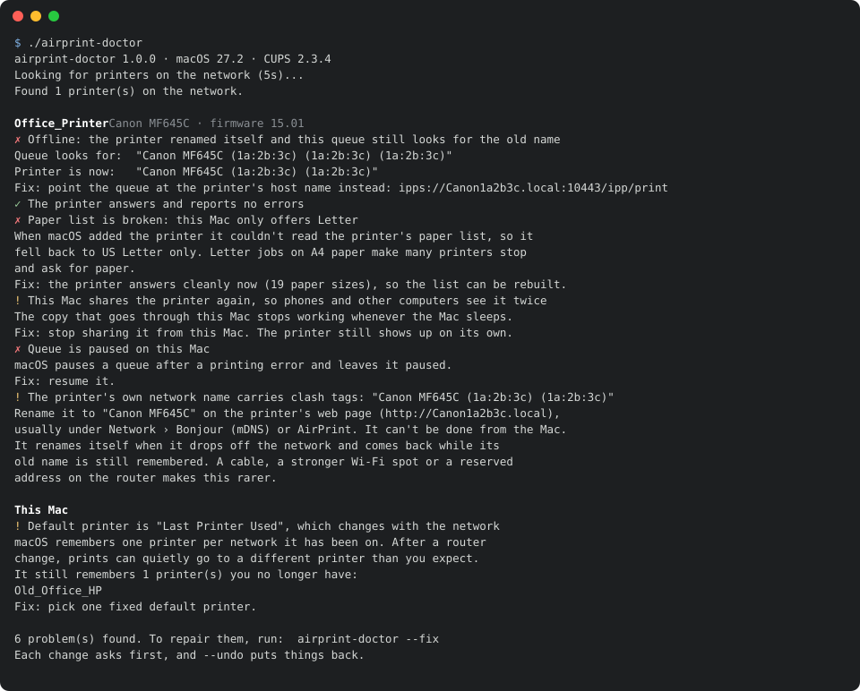

# airprint-doctor

Finds and fixes the usual reasons an AirPrint printer goes **Offline**, prints **US Letter only**, or turns up twice on a Mac. One file of plain shell that uses only commands built into macOS, and it looks before it touches anything.

[](https://github.com/alexklavins/airprint-doctor/actions/workflows/ci.yml)
[](LICENSE)




## Does this sound like your printer?

- The Mac says it is **Offline**, while your phone prints to it fine.
- Its name has grown tags, like `Canon MF645C (1a:2b:3c) (1a:2b:3c)` or `HP LaserJet (2)`.
- The Mac only offers **US Letter**, and the printer stops and asks for paper when you print on A4.
- Prints quietly go to an old printer from another network.
- Your iPhone sees the printer twice, and one copy stops working when the Mac sleeps.
- The queue says **Paused** and nothing comes out.

## Run it

```sh
curl -fsSLO https://raw.githubusercontent.com/alexklavins/airprint-doctor/main/airprint-doctor
chmod +x airprint-doctor
./airprint-doctor
```

It is one readable file, so have a look at it first if you like. On its own it only reports. To repair what it found:

```sh
./airprint-doctor --fix      # asks y/N before each change
./airprint-doctor --undo     # puts back what the last --fix changed
```

## What it checks

| Check | What goes wrong | What `--fix` does |
|---|---|---|
| How the queue finds the printer | macOS saves the printer's Bonjour name. When the printer finds its name taken (often after dropping off Wi-Fi) it renames itself, and the queue keeps looking for the old name: **Offline**. | Points the queue at the printer's `.local` host name, which doesn't change. |
| Paper list | macOS couldn't read the printer's paper list when it was added, so it fell back to Letter only. | Rebuilds the driver file from the printer (the IPP Everywhere way), keeping the printer icon, the Scan button and the two-sided default. |
| Default printer | "Last Printer Used" is remembered per network, so the default changes when the router does. | Sets one fixed default, which you pick. |
| Sharing | The Mac shares a network printer again, so phones see it twice. | Stops sharing that queue. The printer still shows up on its own. |
| Paused queue, stuck jobs | macOS pauses a queue after an error and leaves it paused. | Resumes it. Offers to cancel stuck jobs, and always asks for that one. |
| Fixed IP address | The router gave the printer a new address. | Lets you pick the printer from the ones on the network. |
| Two queues for one printer | Usually left over from adding it again. | Tells you. It never deletes queues. |
| The printer itself | Errors, a name full of clash tags, a broken language code. | Tells you what to change on the printer. |

## Things only the printer can fix

**The renaming.** Set the name back on the printer's own web page (open `http://<printer>.local` in a browser, usually under Network, Bonjour/mDNS or AirPrint). Printers rename themselves when they drop off the network and come back while their old name is still remembered, so a cable, a stronger Wi-Fi spot or a reserved address on the router makes it happen less often. A queue pointed at the host name keeps working either way.

**Letter only, caused by the printer.** Some printers, Canon imageCLASS / i-SENSYS models among them, send a broken language code (`en-` followed by spaces). macOS and Linux reject the whole answer, so the paper list never arrives. The CUPS maintainers [declined to work around it](https://github.com/OpenPrinting/cups/pull/1467) in January 2026, so it has to be fixed on the printer: update its firmware, or change its Country/Region setting, which fixes it on some models. airprint-doctor spots the broken code and says so, then rebuilds the paper list once the printer answers cleanly.

## Safe by design

- It only looks unless you pass `--fix`, and then it asks before each change.
- `--yes` answers for real problems only. Optional changes and cancelling jobs still need a typed `y`.
- Before the first change it saves the queue's address, its driver file, its sharing setting and the Mac's default-printer setting to `~/Library/Application Support/airprint-doctor/backups/<time>/`, with a log of every command it ran. `--undo` puts the latest one back.
- It never deletes a queue and never changes settings on the printer.
- It talks only to printers on your own network, to ask them about themselves. Nothing is sent anywhere else.
- It uses only `lpstat`, `lpadmin`, `lpoptions`, `ippfind`, `ipptool`, `cupsenable`, `cupsaccept`, `cancel`, `defaults` and `nc`, all part of macOS. No Homebrew, no Python.
- Like System Settings, changing printers needs an administrator account.

## Asking for help with a report

```sh
./airprint-doctor --report
```

Runs the same checks and removes IP addresses, host names, MAC-style tags, ids, queue names and your user name, so the output can go into a forum post or a GitHub issue.

## Options

```
  -p, --printer NAME   check only this queue (the name lpstat -v shows)
  -t, --timeout SEC    how long to look for printers on the network (default 5)
  -y, --yes            with --fix: say yes to every fix except cancelling jobs
      --no-color       plain output
```

Exit status is 0 when nothing is wrong, 1 when problems are found or left, and 2 when it could not run, so it also works from a script or an MDM. `AIRPRINT_DOCTOR_BACKUPS` moves the backup folder.

## Doing it by hand

If you would rather not run a script, these are the commands it uses:

```sh
lpstat -v                                     # how each queue finds its printer
ippfind -T 5 _ipps._tcp -x echo '{service_name}  {service_uri}' \;   # printers on the network
lpadmin -p QUEUE -v ipps://HOST.local:PORT/ipp/print                 # point a queue at the host name
lpadmin -p QUEUE -v "$(lpstat -v QUEUE | sed 's/^device for [^:]*: //')" -m everywhere   # rebuild the paper list
lpadmin -p QUEUE -o printer-is-shared=false   # stop sharing it
cupsenable QUEUE                              # resume a paused queue
defaults write org.cups.PrintingPrefs UseLastPrinter -bool false && lpoptions -d QUEUE   # fixed default printer
```

The hand-made `-m everywhere` file loses the printer icon and the Scan button. airprint-doctor copies those over from the old file.

## Tested on

| Mac | Printer |
|---|---|
| macOS 27.2 (CUPS 2.3.4), Apple silicon | Canon i-SENSYS MF645C, firmware 15.01. The Letter-only state from firmware 08.02 was rebuilt from a saved driver file. |

It should work with any AirPrint or IPP Everywhere printer, but that one is all I have tested. If you run it on another printer, please open an issue with your `--report` output, good or bad, and I will add it to this table.

## Why this exists

My Canon kept showing Offline on the Mac while the phones printed to it happily. The queue turned out to be looking for a printer called `Canon MF645C (1a:2b:3c) (1a:2b:3c) (1a:2b:3c) (1 (1a (1a:2b:3c)`, a name it had grown through one clash after another, and on top of that the Mac only offered Letter paper, had quietly made an old office printer the default, and was sharing the Canon a second time to the phones. Each of these is a known problem with a known fix, but they are scattered across years of forum threads, so I put the checks and the fixes in one place.

## Licence

MIT © 2026 Aleksandrs Kļaviņš · alexander.klavinsh@gmail.com

Not affiliated with Apple. AirPrint and macOS are trademarks of Apple Inc.
